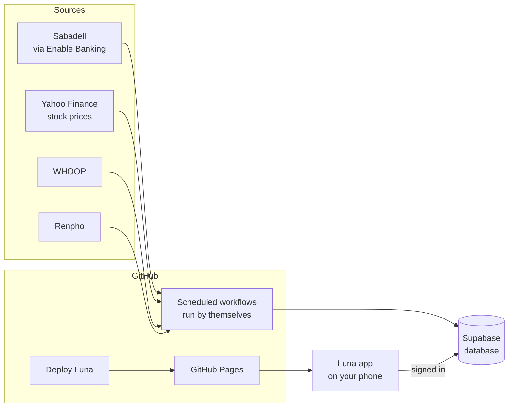

# Luna

A personal dashboard that lives on your phone: your spending, your stocks, your WHOOP recovery and sleep, your weight, and your workouts and meals, all in one app and updated by itself every day.

**New here? Start with [docs/setup.md](docs/setup.md).** It walks through everything step by step. No coding needed.

---

## What it shows

| Area | Where the data comes from | How often | Where it shows up |
|------|---------------------------|-----------|-------------------|
| **Spending** | Your bank (Banco Sabadell), through Enable Banking | Every morning | Finances → Expenses, money alerts |
| **Stocks** | What you list in the `holdings` table, priced from Yahoo Finance | Every weekday evening | Finances → Investments, Hub |
| **Recovery, sleep, strain** | WHOOP band | 5 times a day | Hub, Fitness, Workouts, Food |
| **Weight and body fat** | Renpho smart scale | Every morning | Weight, Fitness |
| **Workouts and meals** | You log them in the app | When you log them | Workouts, Food |

---

## How it works



1. **Workflows** on GitHub wake up on a timer, collect new data from each service, and save it.
2. **Supabase** is the database that keeps everything.
3. **Luna** is the app. GitHub Pages hosts it for free; you add it to your phone's home screen.

No servers to run and nothing to pay for.

---

## Documentation

| I want to... | Read |
|--------------|------|
| Set it up | [docs/setup.md](docs/setup.md) |
| Fix something or do a common task | [docs/operations.md](docs/operations.md) |
| Know what's in the database | [docs/tables.md](docs/tables.md) |
| Change the app's code | [app/README.md](app/README.md) |

---

## Repo layout

```
├── app/            The app itself. Personal settings (name, currency, kg/lb) are in app/src/config.js.
├── finances/       Bank sync, money alerts, stock prices.
├── health/         WHOOP and Renpho syncs.
├── supabase/       schema.sql builds the whole database in one step.
├── docs/           Setup guide, how to fix things, database reference.
└── .github/        The workflows (the automatic jobs).
```

---

## Security

- **No passwords or keys in the code.** They live in GitHub Secrets and in the database, never in these files.
- **The app needs a real sign in.** Supabase emails you a code. The 4 digit code on open is just a quick lock.
- **The database only answers your account.** Every table only lets your signed in email read or write it.
- **Bank access is read only** and goes through the official EU open banking rules. It can't move money.
